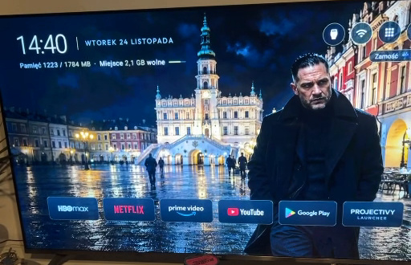
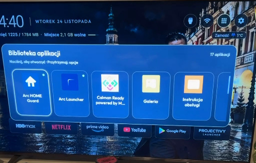
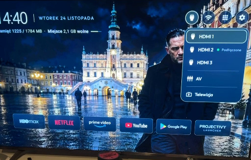

# Sapphire Executive TV

**A custom Android TV home screen for Xiaomi TV A Pro 55 (2026).**  
CleanYourTV-based interface · graphite and champagne accents · remote-first navigation

*V4 on the actual TV, 24 November 2026. Cropped frame from the owner's phone recording, not a design mockup or direct ADB screenshot.*

[Polski opis](docs/README.pl.md) · [Implementation notes](docs/implementation.md) · [MIT license](LICENSE)

## What it does

| Feature | Implementation |
| --- | --- |
| Six favorite apps | HBO Max, Netflix, Prime Video, YouTube, Google Play, Projectivy |
| App library | Native CleanYourTV catalogue; 17 apps visible in the V4 recording |
| System information | Live RAM usage, storage availability and a native RAM bar |
| Clock and date | Dynamic Polish header and champagne accent |
| Weather | Fixed-city Zamość forecast via Open-Meteo; foreground-triggered requests, 30-minute refresh after success |
| Remote navigation | Existing D-pad, focus handling, and native input controls |
| Inputs | Existing HDMI, AV and television source picker |
| Wallpaper | Existing personal night-time Zamość artwork retained |
| Update safety | Local backup, package/version/certificate checks, offline Gradle build, unit tests, in-place APK update |

## On-device gallery

| App library | HDMI menu |
| --- | --- |
|  |  |

These are cropped frames from the same real recording. Camera exposure and TV settings affect the displayed colors. No UI elements were drawn over the images.

## Test device

| Component | Configuration |
| --- | --- |
| TV | Xiaomi TV A Pro 55 (2026), MiTV-MZTU0 / river |
| OS | Android TV 14 |
| Memory | 2 GB class; 1784 MB reported by the launcher |
| Panel | 4K |
| Base | [CleanYourTV](https://github.com/Gathin23/cleanyourtv), local version 3.6 |
| Development | Windows, JDK 17, Android SDK 34, Gradle 8.9, ADB |

## Project status

V4 is running on the test TV. The recording demonstrates the home screen, app catalogue, HDMI picker and access to Android network settings. This is a single-device project, not a compatibility claim for other TVs. Long-run performance and reboot persistence are not certified here.

Known limitations: dark wallpaper areas appear grainy in the phone footage; menu colors still appear more blue than intended. A native screen capture is needed to separate source-image issues from display processing and camera compression.

## Source and availability

The `implementation/` directory contains actual Java components, V4 resource files, helper excerpts and geometry tests used in the local project. It is **not a standalone Android build**; the full locally patched upstream tree and signing material are not distributed. See the implementation notes for the boundaries of this snapshot. Do not uninstall a working launcher to resolve a signature mismatch.

## Credits

Built on [Gathin's CleanYourTV](https://github.com/Gathin23/cleanyourtv) ([base commit](https://github.com/Gathin23/cleanyourtv/tree/fe6cdcefa817da9f6facd3a17a3c5a086124f258), MIT). Weather data: [Open-Meteo](https://open-meteo.com/). App names and logos belong to their respective owners. Not affiliated with Xiaomi, streaming providers or the upstream maintainer.
