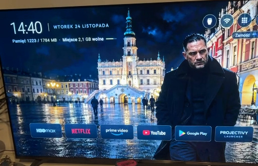
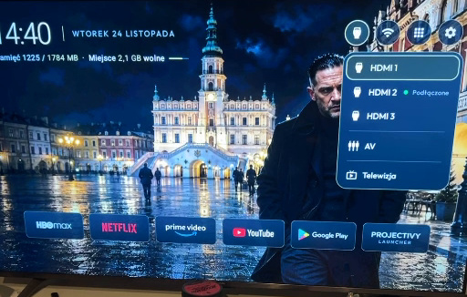

# Sapphire Executive TV

Polski, minimalistyczny ekran główny Android TV na Xiaomi A Pro 55 (2026). Projekt rozwijany na bazie CleanYourTV, z zachowaniem obsługi pilota i funkcji systemowych.

## Funkcje

- Stały rząd sześciu aplikacji, osobna biblioteka pozostałych programów.
- Zegar, polska data, dynamiczne wykorzystanie RAM i wolne miejsce.
- Pasek RAM oraz pogoda dla Zamościa z Open-Meteo.
- Własna stylistyka grafitowo-granatowa i szampańskie akcenty.
- Natywny wybór HDMI i dostęp do ustawień Android TV.
- Aktualizacja APK z kopią zapasową, weryfikacją certyfikatu i testami Gradle.

## Rzeczywisty wygląd

Klatki z nagrania fizycznego telewizora z 24.11.2026, wykadrowane bez zmiany kolorów. Nie są cyfrowymi zrzutami ADB. Wersja V4 działa na egzemplarzu testowym; długotrwała wydajność i zachowanie po restarcie nie zostały udokumentowane w tym nagraniu.

## Dalsze poprawki

Redukcja ziarnistości ciemnych obszarów tapety, sprawdzenie ustawień wyostrzania i porównanie barw menu z cyfrowym zrzutem ADB. Bez zmiany kompozycji tapety.

Kod i ograniczenia: [dokumentacja techniczna](implementation.md). Projekt bazowy: [CleanYourTV](https://github.com/Gathin23/cleanyourtv) (MIT).
