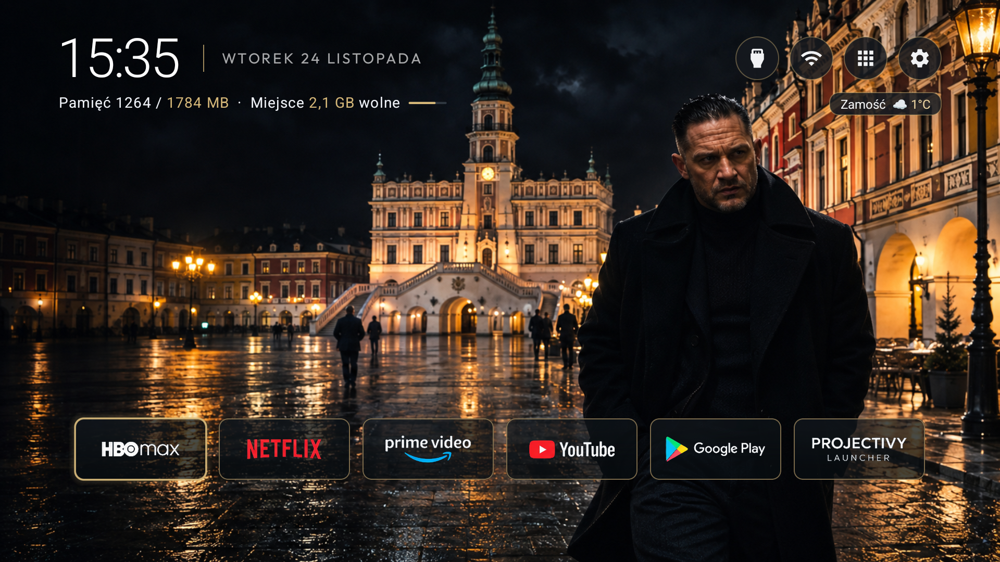
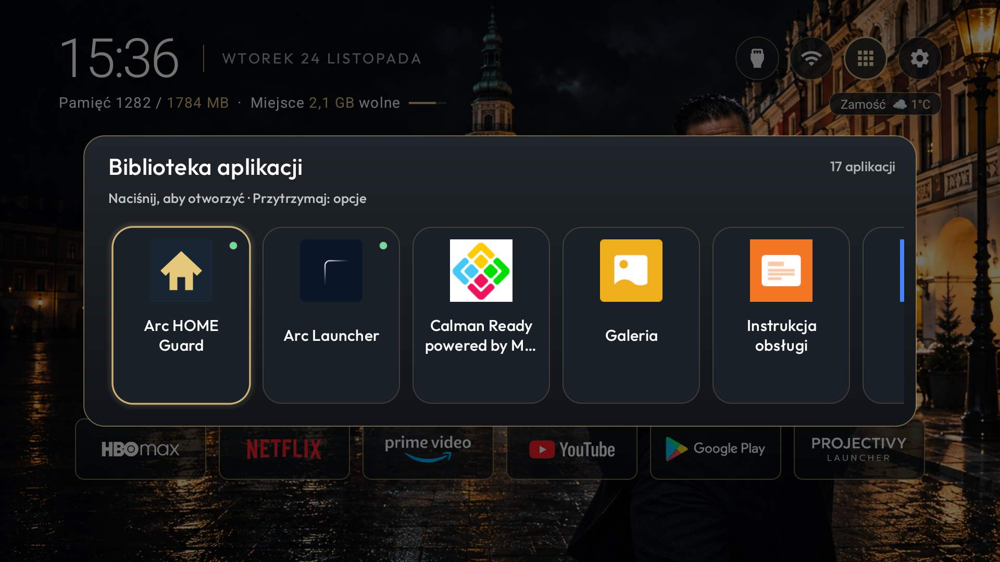
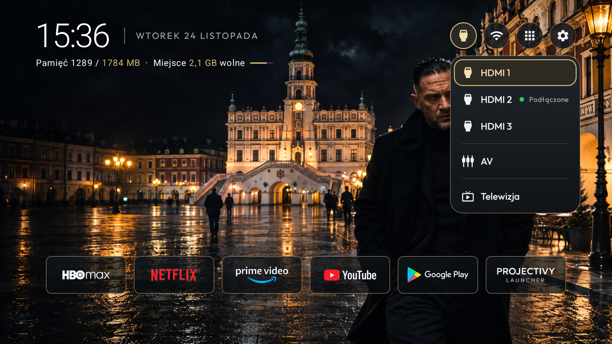

# Sapphire Executive TV

Polski, minimalistyczny ekran główny Android TV na Xiaomi A Pro 55 (2026). Projekt rozwijany na bazie CleanYourTV, z zachowaniem obsługi pilota i funkcji systemowych.

## Funkcje

- Stały rząd sześciu aplikacji, osobna biblioteka pozostałych programów.
- Zegar, polska data, dynamiczne wykorzystanie RAM i wolne miejsce.
- Pasek RAM oraz pogoda dla Zamościa z Open-Meteo.
- Własna stylistyka grafitowo-granatowa i szampańskie akcenty.
- Natywny wybór HDMI i dostęp do ustawień Android TV.
- Aktualizacja APK z kopią zapasową, weryfikacją certyfikatu i testami Gradle.

## Rzeczywisty wygląd

Trzy oryginalne zrzuty PNG 1920 × 1080 wykonane przez ADB na działającej wersji V6.2. Bez zdjęć aparatem, kadrowania i retuszu. Przezroczystość tła kafelków wynosi 25%. Raport nie potwierdza wygaszacza ani długotrwałej wydajności. [Wyniki i ograniczenia QA](qa-v62.md).
Kod i ograniczenia: [dokumentacja techniczna](implementation.md). Projekt bazowy: [CleanYourTV](https://github.com/Gathin23/cleanyourtv) (MIT).
